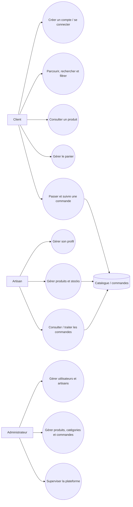
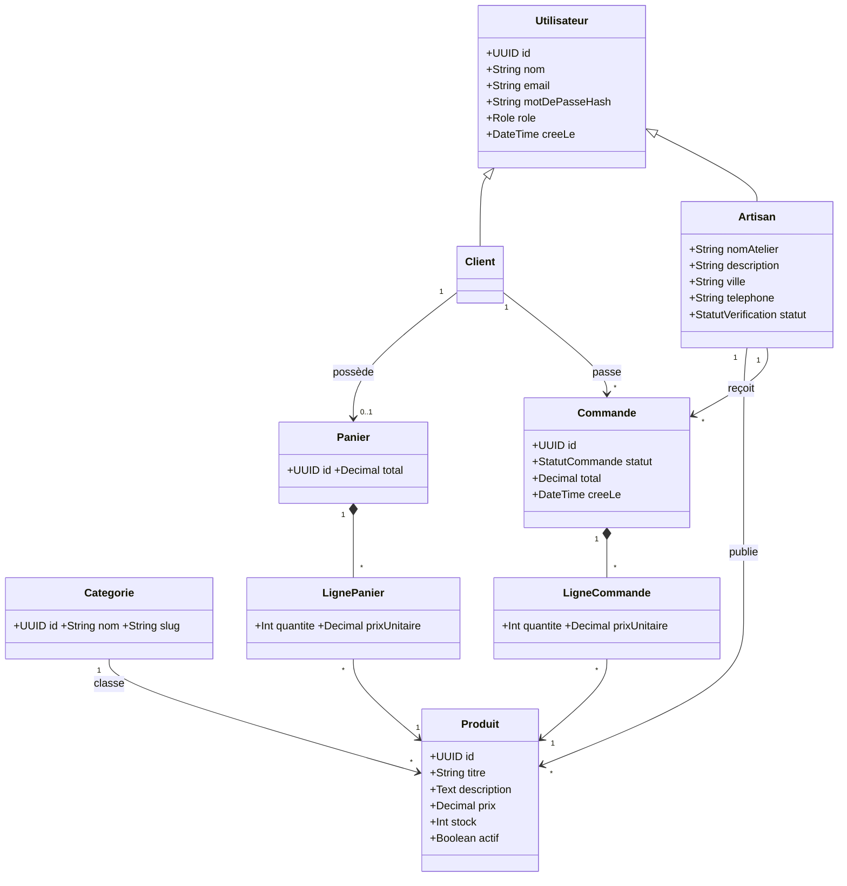
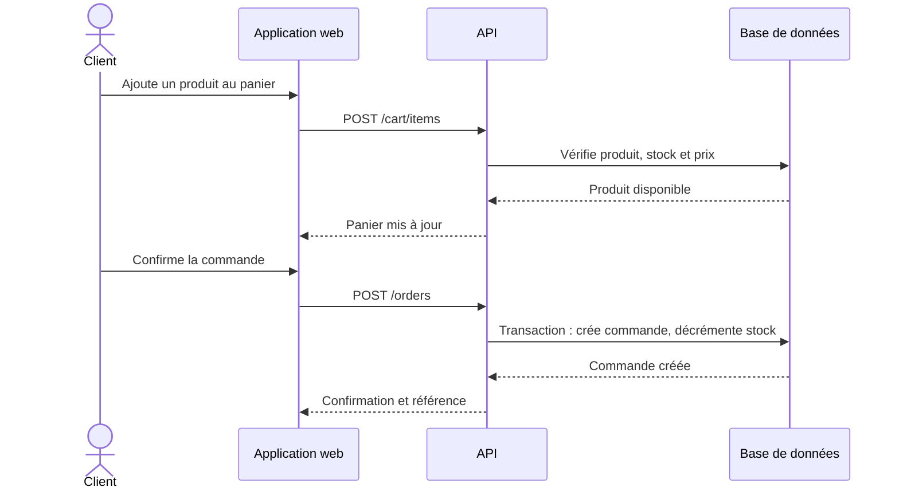
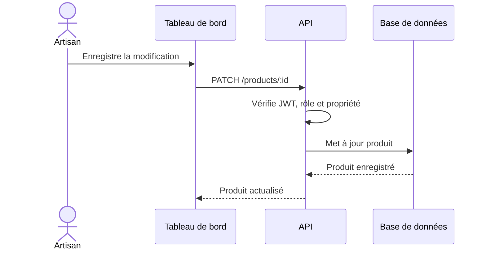
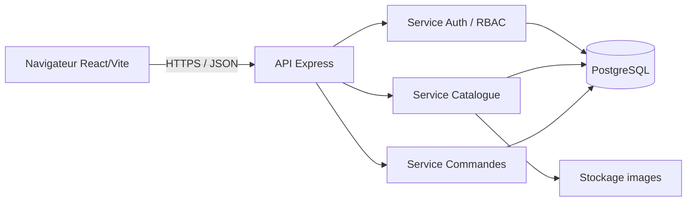

# Cahier des charges — ArtisanConnect
## Plateforme marketplace pour l'artisanat marocain
**Version :** 1.0 · **Date de référence :** 8 novembre 2026 · **Statut :** document de cadrage pédagogique

> **Hypothèses de cadrage.** L'équipe doit proposer un planning de huit semaines de cinq jours ouvrés et suppose une équipe de quatre étudiants : chef·fe de projet/analyste, concepteur·rice UX, développeur·se back-end et développeur·se front-end/intégrateur·rice. Le paiement en ligne, la livraison et les notifications externes ne sont pas inclus dans le MVP : une commande est une demande confirmée par l'artisan. Les choix techniques proposés sont à valider avec l'encadrant.

## 1. Présentation générale
### 1.1 Projet, contexte et problématique
ArtisanConnect est une plateforme web qui met en relation des artisans marocains et des clients désirant découvrir et acheter des produits artisanaux. Le projet répond à la faible visibilité numérique de nombreux ateliers, à la difficulté de comparer une offre dispersée et au besoin d'un suivi structuré des demandes de commande.

Le dépôt existant contient une application nommée **Al Asel**, fondée sur Flutter et une API Express/Firebase, déjà orientée profils d'artisans, demandes et messagerie. Il ne réalise pas encore le périmètre marketplace complet décrit ici (catalogue de produits, panier, commande et stock). Le présent dossier est un cadrage cible : l'équipe doit décider avec l'encadrant si elle l'étend à l'existant ou le réalise comme module séparé.

### 1.2 Justification et objectifs
La plateforme valorise le savoir-faire local, facilite la découverte par catégorie et centralise le cycle catalogue → panier → commande. Objectifs généraux : livrer un MVP démontrable, sécurisé et responsive; pratiquer l'analyse, la conception UML, la planification et les tests.

Objectifs spécifiques : permettre au client de trouver un produit; permettre à l'artisan de gérer un catalogue et son stock; donner à l'administrateur les outils de modération; conserver une trace fiable des commandes.

### 1.3 Public cible et périmètre
Public cible : clients particuliers, artisans/ateliers marocains et administrateur de plateforme. Le MVP couvre l'authentification, le catalogue, la recherche, le panier, les commandes, le stock et l'administration. Hors périmètre : paiement réel, calcul automatique de livraison, multi-vendeurs dans une même commande, application native, traduction complète et intégration ERP.

## 2. Étude des besoins
### 2.1 Acteurs
| Acteur | Finalité | Droits principaux |
|---|---|---|
| Visiteur | Découvrir l'offre | consulter catalogue public |
| Client | Acheter et suivre ses demandes | compte, panier, commandes |
| Artisan | Vendre ses créations | profil, produits, stocks, commandes reçues |
| Administrateur | Garantir la qualité de la place de marché | modération, catégories, supervision |

### 2.2 Besoins fonctionnels
Le système doit gérer l'inscription/connexion et les rôles; exposer un catalogue public avec catégories, recherche et filtres; afficher une fiche produit; conserver un panier par client; créer une commande; afficher les historiques; permettre à l'artisan de gérer profil, produits, stock et statuts de commande; permettre à l'administrateur de modérer utilisateurs, artisans, produits, catégories et commandes.

### 2.3 Besoins non fonctionnels
| Domaine | Exigence mesurable pour le MVP |
|---|---|
| Sécurité | mots de passe hachés (Argon2/bcrypt), TLS en production, contrôle d'accès par rôle, validation serveur |
| Performance | pages catalogue perçues en moins de 3 s sur connexion normale; pagination côté serveur |
| Ergonomie | parcours d'achat en 3 étapes maximum après panier; messages d'erreur explicites |
| Disponibilité | objectif pédagogique : service déployable et récupération d'erreurs; pas de SLA contractuel |
| Maintenabilité | API versionnée, composants réutilisables, linting, README et tests automatisés |
| Responsive | fonctionnement de 360 px à bureau; tests Chrome/Firefox récents |
| Données | minimisation, consentement/notice, aucune donnée bancaire stockée |

### 2.4 Contraintes, hypothèses et limites
Stack recommandée : React/Vite + Node.js/Express + PostgreSQL/Prisma ou adaptation prudente de l'API Express/Firebase existante. Git/GitHub, Trello et Mermaid sont obligatoires pour le suivi pédagogique. L'équipe ne doit pas affirmer la conformité légale ou la mise en production sans validation humaine.

## 3. Spécifications fonctionnelles
### 3.1 Client
| ID | Fonction | Description et acceptation |
|---|---|---|
| F-CLI-01 | Inscription/connexion | créer un compte, se connecter/se déconnecter; champs invalides et identifiants erronés sont traités |
| F-CLI-02 | Catalogue | consulter une liste paginée de produits actifs avec image, prix, artisan et catégorie |
| F-CLI-03 | Recherche/filtres | rechercher par texte et filtrer au minimum par catégorie, ville et fourchette de prix; combinaison conservée dans l'URL |
| F-CLI-04 | Fiche produit | consulter description, images, stock disponible, prix et artisan |
| F-CLI-05 | Panier | ajouter, modifier quantité, supprimer; total recalculé côté serveur |
| F-CLI-06 | Commande | confirmer une commande mono-artisan, recevoir référence et statut initial `en_attente` |
| F-CLI-07 | Historique | voir uniquement ses commandes et leur détail |

### 3.2 Artisan
| ID | Fonction | Description et acceptation |
|---|---|---|
| F-ART-01 | Compte/profil | renseigner atelier, description, ville, téléphone et photo facultative |
| F-ART-02 | Produits | créer, modifier, activer/désactiver ou supprimer ses produits; aucun accès aux produits d'autrui |
| F-ART-03 | Stocks | saisir un entier positif; produit indisponible si stock zéro |
| F-ART-04 | Commandes | consulter les commandes de ses produits et faire évoluer `en_attente → acceptee/refusee → preparee → terminee` |

### 3.3 Administrateur
| ID | Fonction | Description et acceptation |
|---|---|---|
| F-ADM-01 | Utilisateurs/artisans | lister, rechercher, activer/suspendre et valider un artisan |
| F-ADM-02 | Produits | consulter, masquer/restaurer un produit non conforme avec motif |
| F-ADM-03 | Commandes | consulter les commandes et leurs statuts sans modifier le contenu métier |
| F-ADM-04 | Catégories | créer, renommer, ordonner ou désactiver une catégorie non utilisée |

## 4. Spécifications non fonctionnelles détaillées
Le serveur est l'autorité pour le prix, le stock et les autorisations. Chaque endpoint protégé vérifie le jeton, le rôle et, pour une ressource artisan, la propriété. Les entrées sont validées, les requêtes sensibles journalisées sans mots de passe, les erreurs ne révèlent pas de détails internes. Les images reçoivent une limite de type/taille et un nom non prédictible. Les migrations, variables d'environnement et sauvegardes sont documentées.

## 5. Règles métier
1. Un compte a exactement un rôle actif : client, artisan ou administrateur; seul l'administrateur attribue le dernier rôle.
2. Un produit est publié par un seul artisan vérifié; titre, catégorie, prix strictement positif et stock entier ≥ 0 sont requis.
3. Un panier ne contient que des produits actifs et disponibles. Pour le MVP, il ne peut contenir que les produits d'un seul artisan; ajouter un autre artisan invite à vider ou terminer le panier.
4. Le prix et le stock sont revérifiés lors de la commande. La création est transactionnelle : commande et lignes sont créées, le stock est décrémenté, sinon aucune modification n'est conservée.
5. Une commande appartient à un client et un artisan; elle ne peut jamais être supprimée. Les changements de statut sont autorisés uniquement suivant le flux défini en F-ART-04.
6. Le client ne peut pas voir les commandes d'un autre client; l'artisan ne voit que les siennes; l'administrateur voit tout.
7. Un produit déjà présent dans une commande est archivé/désactivé, jamais effacé physiquement, afin de préserver l'historique.

## 6. Modélisation UML
### 6.1 Cas d'utilisation

### 6.2 Diagramme de classes

### 6.3 Diagrammes de séquence
### Scénario S1 — passer une commande

### Scénario S2 — artisan met à jour un produit

## 7. Architecture proposée
Architecture web trois couches : un front-end React responsive communique en HTTPS avec une API REST `/api/v1`; l'API Express applique authentification, validation et règles métier; PostgreSQL conserve les données relationnelles et un stockage objet conserve les médias. Cette architecture reste réalisable par des étudiants, teste les services sans navigateur et évite de placer des secrets dans le front-end.

## 8. Planning prévisionnel
Commencez par `../02_Gestion_de_projet/01_Tableau_activites_Gantt_PERT.md` : il fournit les événements, durées estimées et étapes précédentes. L'équipe construit ensuite son propre planning dans `02_Diagramme_Gantt.mmd` et son PERT dans `03_Diagramme_PERT.md`. Ces fichiers fournissent une méthode et des gabarits, pas une solution prédéfinie. Les documents, la préparation de soutenance et certaines maquettes peuvent généralement être étudiés comme activités parallélisables; l'équipe doit justifier les dépendances réellement retenues.

## 9. Critères de validation globaux
- Les scénarios F-CLI-01 à F-CLI-07, F-ART-01 à F-ART-04 et F-ADM-01 à F-ADM-04 sont démontrés avec données de test.
- Les permissions interdites retournent une réponse contrôlée et ne modifient aucune donnée.
- Une commande refuse une quantité supérieure au stock et conserve le prix validé au moment de la création.
- Le catalogue fonctionne sur mobile et bureau; les erreurs et états vides sont traités.
- Les tests automatisés essentiels passent, le README permet une installation reproductible et la recette signée est archivée.

## 10. Conclusion et perspectives
Le MVP privilégie un parcours fiable plutôt qu'une large couverture fonctionnelle. Après validation, les évolutions possibles sont paiement sécurisé via prestataire, livraison, avis vérifiés, messagerie, multi-vendeur, langues arabe/français et tableau de bord analytique.
