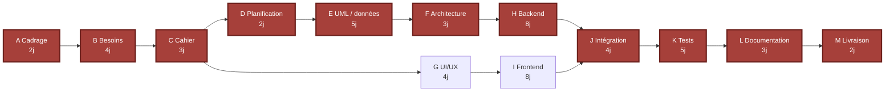

# Diagramme PERT — ArtisanConnect
## Données de calcul
Calendrier : 5 jours ouvrés/semaine, démarrage le 09/11/2026. Les durées sont des estimations pédagogiques, pas des charges constatées. Les activités critiques sont **A → B → C → D → E → F → H → J → K → L → M**, pour une durée totale de **40 jours ouvrés**, soit huit semaines.

| Act. | Activité | Durée | Prédécesseur | ES | EF | LS | LF | Marge |
|---|---|---:|---|---:|---:|---:|---:|---:|
| A | Cadrage et kickoff | 2 | — | 0 | 2 | 0 | 2 | 0 |
| B | Besoins/personas | 4 | A | 2 | 6 | 2 | 6 | 0 |
| C | Cahier des charges | 3 | B | 6 | 9 | 6 | 9 | 0 |
| D | Backlog/planification | 2 | C | 9 | 11 | 9 | 11 | 0 |
| E | UML et modèle de données | 5 | D | 11 | 16 | 11 | 16 | 0 |
| F | Architecture/API/environnement | 3 | E | 16 | 19 | 16 | 19 | 0 |
| G | Wireframes/design system | 4 | C | 9 | 13 | 15 | 19 | 6 |
| H | Noyau back-end | 8 | F | 19 | 27 | 19 | 27 | 0 |
| I | Parcours front-end | 8 | G | 13 | 21 | 19 | 27 | 6 |
| J | Intégration | 4 | H, I | 27 | 31 | 27 | 31 | 0 |
| K | Tests et recette | 4 | J | 31 | 35 | 31 | 35 | 0 |
| L | Documentation | 3 | K | 35 | 38 | 35 | 38 | 0 |
| M | Livraison/soutenance | 2 | L | 38 | 40 | 38 | 40 | 0 |

### Vérification mathématique
Passage avant : `EF = ES + durée`; ainsi EF(M) = 38 + 2 = **40**. Passage arrière depuis LF(M)=40 : `LS = LF − durée`; pour chaque prédécesseur, `LF = min(LS des successeurs)`. La marge `LS − ES` est nulle pour A, B, C, D, E, F, H, J, K, L et M : leur chaîne est donc critique. G et I ont chacun 6 jours de marge; tout retard au-delà de cette marge retarde J et la livraison.
