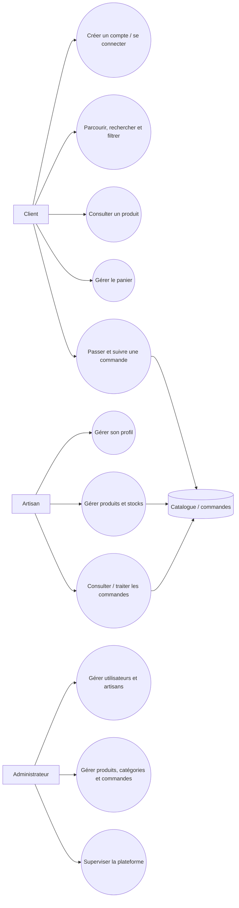
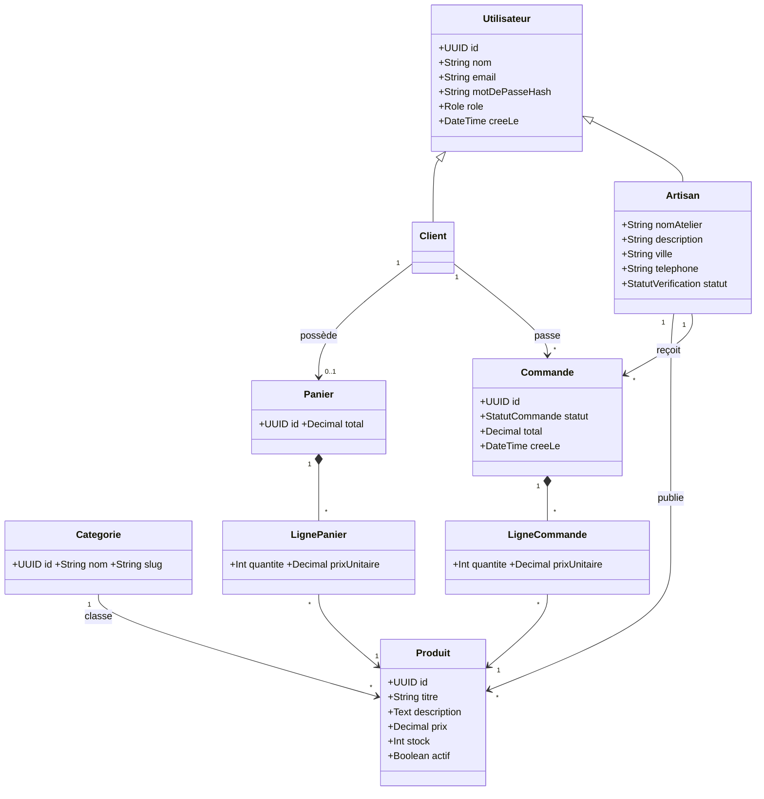
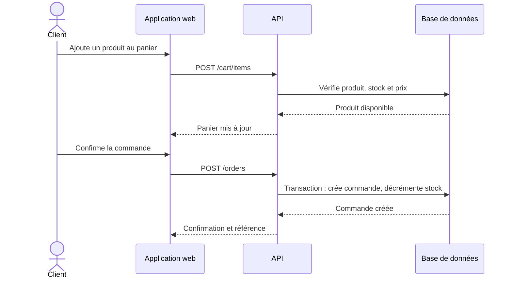
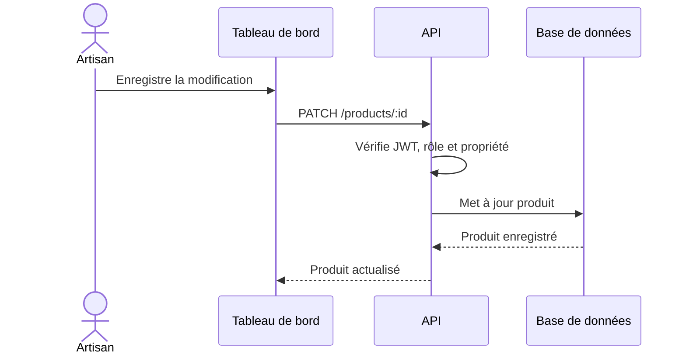

# Diagrammes UML — ArtisanConnect

Les diagrammes de cas d'utilisation, classes et séquences sont inclus dans le cahier des charges afin de garder les règles métier et leur représentation synchronisées.

### Scénario S1 — passer une commande

### Scénario S2 — artisan met à jour un produit

